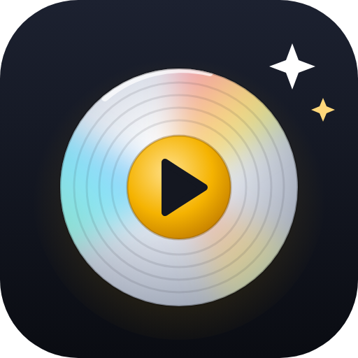

<p align="center"></p>

# Diskoteket

> [!WARNING]
> **Vibecodat projekt.** All kod här är skriven av Claude (AI från Anthropic) efter ägarens önskemål –
> inte av en professionell utvecklare. Koden har inte granskats av någon som kan programmering.
> Använd den gärna, men på egen risk, och ta säkerhetskopior.

Egen film-, serie- och musiksamling som du kör själv, till exempel som Docker-container på Unraid.
Mobilanpassad webbsida med streckkodsskanning, flera samlingar, import från CLZ Movies och CLZ Music,
omslag från TMDB och MusicBrainz, och koppling till Plex/Jellyfin och Home Assistant.

## Funktioner

- **Skanna streckkoder** med mobilkameran. Okända filmkoder slås upp i MyMovies (nordiska utgåvor),
  UPCitemdb och valfritt EAN-DB. Koder du kopplar till en film kommer appen ihåg.
- **Musik** på en egen flik i samma samlingar: album med artist, skivbolag, låtlista och omslag från
  **MusicBrainz** (gratis) och valfritt **Discogs**. Skanna CD- och vinylstreckkoder eller sök på artist och album.
- **Flera samlingar**, t.ex. ”Mina filmer” och ”Barnens”, plus vy för alla samlingar på en gång.
- **Import från CLZ Movies och CLZ Music** (CSV) – appen känner själv igen vilken. Allt följer med, även utlåning och inköpspris.
- **Omslag** sparade lokalt. Egna omslag via foto, fil eller bildadress, och massimport av många bilder.
- **Lägg till många på en gång**: fortsätt-läge, kö från serieskanning eller klistra in en lista med titlar.
- **Sök** på titel (standard), skådespelare, regissör, artist eller allt.
- Filter, sortering, rutnät i tre storlekar, listvyer, ljust/mörkt tema, ”Nyligen tillagt”-hylla.
- Önskelista, utlåning, inventering av hyllan, slumpa kvällens film, filmserier.
- **Statistik** för film och musik, samlingens värde (inköpspris) och dubbletter (samma titel i flera utgåvor).
- Plex/Jellyfin visar vilka titlar som också finns digitalt – och vilka som **bara** finns digitalt.
- **Home Assistant-integration** (via HACS) med sensorer och ett eget kort där du väljer detaljnivå.
- **Valfri inloggning** med lösenord.
- Automatiska säkerhetskopior som går att **återställa direkt i appen**, och **export** till CSV/JSON.

## Installera på Unraid

Avbilden byggs automatiskt av GitHub vid varje ny version och hämtas från
`ghcr.io/claudemicro222-cmd/diskoteket:latest`.

### Alternativ A – med mallen (enklast)

1. Öppna Unraids terminal (ikonen **`>_`** uppe till höger) och kör:
   ```
   curl -fsSL https://raw.githubusercontent.com/claudemicro222-cmd/diskoteket/main/unraid/install-template.sh | bash
   ```
2. Gå till **Docker → Add Container**.
3. Välj **Diskoteket** i listan **Template** (under *User templates*).
4. Kontrollera porten (8080) och appdata-sökvägen (`/mnt/user/appdata/diskoteket`) och klicka **Apply**.

### Alternativ B – bara i Unraids gränssnitt

**Docker → Add Container** (slå på **Advanced View** uppe till höger) och fyll i:

| Fält | Värde |
|---|---|
| Name | `Diskoteket` |
| Repository | `ghcr.io/claudemicro222-cmd/diskoteket:latest` |
| Icon URL | `https://raw.githubusercontent.com/claudemicro222-cmd/diskoteket/main/unraid/icon.png` |
| WebUI | `http://[IP]:[PORT:8080]/` |
| Network Type | `Bridge` |

Lägg sedan till (längst ner, **Add another Path, Port, Variable…**):

| Typ | Namn | Container | Host / värde |
|---|---|---|---|
| Port | Webbsida | `8080` | `8080` |
| Path | Appdata | `/config` | `/mnt/user/appdata/diskoteket` |
| Variable | PUID | `PUID` | `99` |
| Variable | PGID | `PGID` | `100` |
| Variable | Tidszon | `TZ` | `Europe/Stockholm` |

Klicka **Apply**.

### Första start

1. Öppna `http://<unraid-ip>:8080` (eller klicka på ikonen → **WebUI**).
2. **Meny ☰ → Inställningar**: klistra in din TMDB-nyckel och tryck **Testa nyckeln**.
3. **Meny ☰ → Importera från CLZ**, eller flytta med samlingen från en tidigare installation (se nedan).

### Flytta med samlingen från VM:en / en tidigare installation

1. Stoppa den gamla containern.
2. Kopiera innehållet i dess `data`-mapp (`diskoteket.db`, `posters`, `backup`)
   till `\\tower\appdata\diskoteket\` – **innan** Diskoteket startas på Unraid första gången.
   En gammal `samling.db` byter namn automatiskt.
3. Starta containern. Databasen uppgraderas automatiskt.

### Uppdatera

- **Manuellt:** Docker-fliken → **Check for Updates** → **apply update** på Diskoteket.
  (Eller avancerad vy → **Force update**.)
- **Automatiskt:** installera **CA Auto Update Applications** från Apps och slå på uppdatering för Diskoteket.

Dina data i appdata påverkas aldrig av en uppdatering. Ta ändå gärna en säkerhetskopia först (Meny → Säkerhetskopior).

**Gå tillbaka till en tidigare version:** varje version finns också med sitt nummer, t.ex.
`ghcr.io/claudemicro222-cmd/diskoteket:4.0`. Byt `latest` mot versionsnumret under **Repository** i containerns
inställningar och klicka **Apply**. Byt tillbaka till `latest` när du vill ha uppdateringar igen.

### Inloggning

**Meny → Inloggning**: välj ett lösenord. Den som öppnar appen måste då logga in (en gång per enhet).
Slå på det om appen nås utanför hemmet. Glömt lösenordet? Ta bort `auth.json` i appdata-mappen och starta om containern.

### Kameran på mobilen

Webbläsare släpper bara fram kameran över **HTTPS**. Lägg Diskoteket bakom en reverse proxy med certifikat
(t.ex. Nginx Proxy Manager eller SWAG), eller nå den via Tailscale. Tills dess kan streckkoder och titlar skrivas in för hand.

## Allt viktigt ligger i appdata

```
/mnt/user/appdata/diskoteket/
├── diskoteket.db     samlingar, titlar, album, inställningar, inlärda streckkoder
├── auth.json         lösenord (som hash) och API-nyckel – finns bara om inloggning är på
├── posters/          omslag (från TMDB, MusicBrainz/Discogs och dina egna)
└── backup/           automatiska säkerhetskopior
```

Filerna ägs av 99:100 (nobody:users), precis som andra Unraid-appar.

**Återställa en säkerhetskopia:** **Meny → Säkerhetskopior → Återställ** på en av appens egna kopior, eller
**Återställ från fil…** för en `.db`-fil du har sparat. Appen tar först en kopia av nuvarande databas, så det går
alltid att ångra. Kopior från äldre versioner uppgraderas automatiskt.

**Exportera:** **Meny → Exportera** ger hela samlingen som CSV (kalkylark) eller JSON.

## Köra på en vanlig dator (Docker Desktop)

```
docker compose up -d                              # hämtar färdig avbild
docker compose pull && docker compose up -d       # uppdatera
docker compose -f docker-compose.yml -f docker-compose.dev.yml up -d --build   # bygg från koden
```

Öppna http://localhost:8080. Data sparas i mappen `data` bredvid filerna.

## Egna omslag i mängd

**Meny → Importera omslag**: välj många bilder eller en zip-fil. Döp bilderna efter
streckkod (`7319980033032.jpg`) eller titel, gärna med år (`Evil Dead (1981).jpg`).

## Musik

1. Exportera från CLZ Music: **CSV**, alla fält.
2. **Meny → Importera från CLZ**, välj filen och samlingen. Musik och film kan ligga i samma samling.
3. Låtlistor och skivomslag hämtas sedan i bakgrunden från MusicBrainz – några sekunder per skiva
   (MusicBrainz tillåter bara ett anrop per sekund). Följ förloppet i menyn.

Vill du ha bättre träffar på ovanliga utgåvor och vinyl: skapa en gratis nyckel på discogs.com
(Settings → Developers → *Generate new token*) och klistra in den under **Meny → Inställningar → Musik**.

## Home Assistant

### Integration och kort (rekommenderas)

1. **HACS → ⋮ → Anpassade arkiv**: lägg till `https://github.com/claudemicro222-cmd/diskoteket` som typ **Integration**.
2. Sök på **Diskoteket** i HACS, installera och starta om Home Assistant.
3. **Inställningar → Enheter och tjänster → Lägg till integration → Diskoteket**. Ange adressen, t.ex.
   `http://192.168.1.10:8080`. Har du slagit på inloggning behövs API-nyckeln från **Meny → Inloggning**.
4. Lägg till kortet **Diskoteket** på en instrumentpanel och välj detaljnivå i kortets inställningar:
   - **Kompakt** – antal filmer, serier och album.
   - **Standard** – siffror för allt, försenade lån och senast tillagd.
   - **Detaljerad** – även omslag för det senast tillagda, samlingar och format.

Kortet följer med integrationen och laddas automatiskt. Integrationen ger också sensorer (filmer, serier, album,
osedda, önskelista, utlånat, försenade lån, värde, senast tillagd) som går att använda i egna automationer.

### Utan integration

`GET /api/ha` ger en JSON-sammanfattning. Färdig YAML för en REST-sensor finns under **Meny → Home Assistant**.

## Utveckling

```
pip install -r requirements.txt -r requirements-dev.txt
python -m pytest -q                                          # alla tester
CONFIG_DIR=./data uvicorn app.main:app --reload --port 8080  # starta lokalt
```

GitHub kör testerna vid varje push, och bygger bara en ny avbild om de går igenom.

## Kod

| Fil | Innehåll |
|---|---|
| `app/main.py` | webbserver (Starlette), API och inloggningsspärren |
| `app/db.py` | databasen och automatiska uppgraderingar |
| `app/repo.py` | samlingar, listor, sökning, statistik, dubbletter, export, backup och återställning |
| `app/barcodes.py` | streckkodsuppslag för film (inlärda, MyMovies, UPCitemdb, EAN-DB) |
| `app/music.py` | musik: MusicBrainz, Discogs, låtlistor och skivomslag |
| `app/auth.py` | lösenord och API-nyckel |
| `app/covers.py` | egna omslag och massimport |
| `app/enrich.py` | hämtning från TMDB och ”Uppdatera metadata” |
| `app/tmdb.py` | TMDB-anrop |
| `app/posters.py` | lokala omslag |
| `app/settings.py` | inställningssidan |
| `app/clz_import.py` | import från CLZ Movies och CLZ Music |
| `app/mediaservers.py` | Plex/Jellyfin |
| `app/static/` | själva webbsidan |
| `tests/` | tester (uppgradering av gamla databaser, import, inloggning, återställning, export) |
| `custom_components/diskoteket/` | Home Assistant-integrationen och kortet |
| `unraid/` | Unraid-mall, ikon och installationsskript |
| `.github/workflows/docker.yml` | kör testerna, bygger och publicerar Docker-avbilden |
