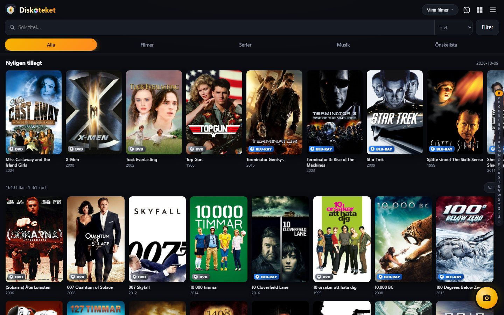
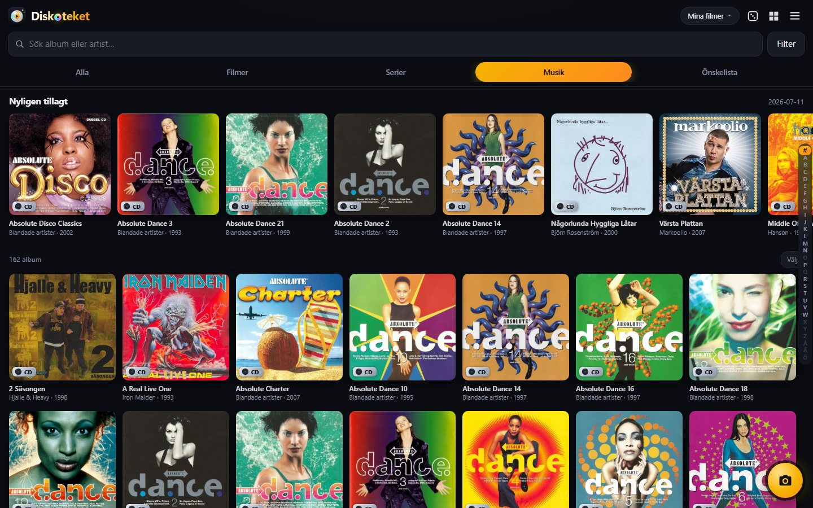
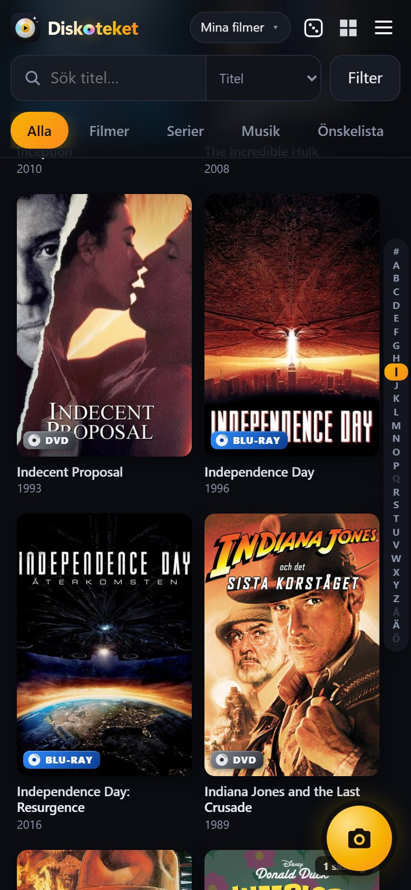
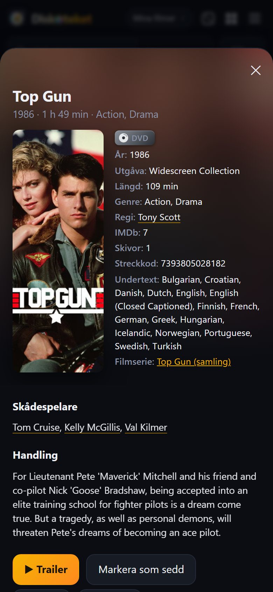
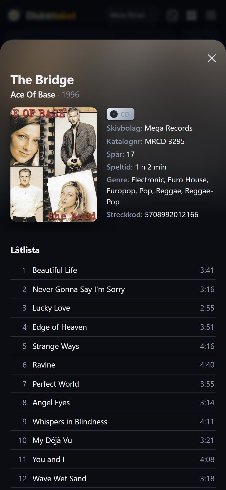
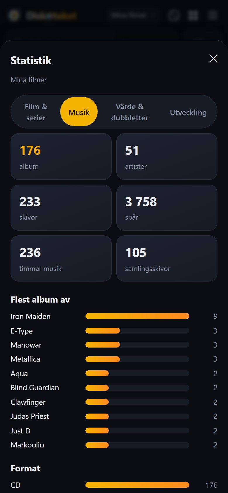
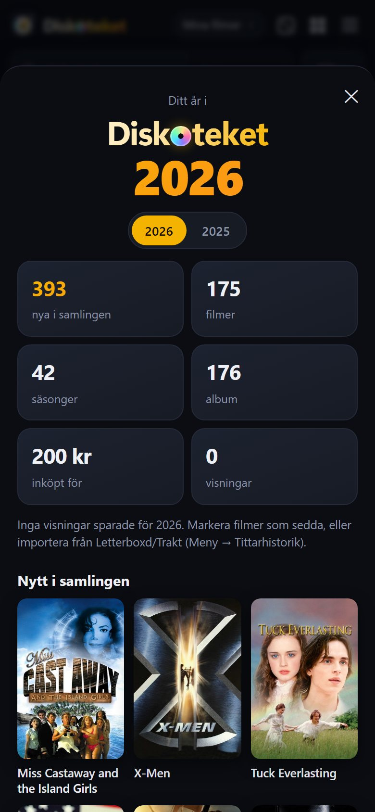
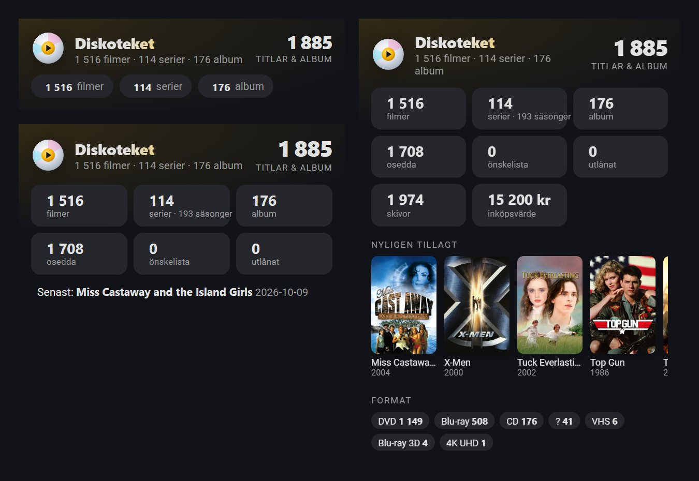

<p align="center"></p>

# Diskoteket

🇬🇧 **English** · 🇸🇪 [Svenska](README.sv.md)

> [!WARNING]
> **Vibe-coded project.** All code here was written by Claude (AI from Anthropic) at the owner's request –
> not by a professional developer. The code has not been reviewed by anyone who knows programming.
> Feel free to use it, but at your own risk, and keep backups.

Your own movie, TV series and music collection that you host yourself, for example as a Docker container on Unraid.
A mobile-friendly web app with barcode scanning, multiple collections, import from CLZ Movies and CLZ Music,
covers from TMDB and MusicBrainz, and integration with Plex/Jellyfin and Home Assistant.

## What it looks like





<table>
  <tr>
    <td align="center" width="25%"><br><sub>Letter bar – jump straight to a letter</sub></td>
    <td align="center" width="25%"><br><sub>Movie page – trailer, actors, collection</sub></td>
    <td align="center" width="25%"><br><sub>Album with track list from MusicBrainz</sub></td>
    <td align="center" width="25%"><br><sub>Statistics for movies, music and value</sub></td>
  </tr>
</table>

<table>
  <tr>
    <td align="center" width="30%"><br><sub>“Your year in Diskoteket”</sub></td>
    <td align="center" width="70%"><br><sub>The Home Assistant card: compact, standard and detailed</sub></td>
  </tr>
</table>

<sub>The screenshots show the owner's collection with the app in Swedish. The app is in English by default.</sub>

## Features

- **Scan barcodes** with your phone camera. Unknown movie barcodes are looked up in MyMovies (Nordic editions),
  UPCitemdb and optionally EAN-DB. Codes you link to a movie are remembered.
- **Search as you type** in the scan box – suggestions with covers, ✓ on what you already own.
- **Music** on its own tab in the same collections: albums with artist, label, track list and cover from
  **MusicBrainz** (free) and optionally **Discogs**. Scan CD and vinyl barcodes or search by artist and album.
- **Multiple collections**, e.g. “My movies” and “Kids”, plus a view of all collections at once.
- **Import from CLZ Movies and CLZ Music** (CSV) – the app recognizes which one. Everything comes along, including loans and purchase prices.
- **Covers** stored locally. Your own covers via photo, file or image address, and bulk import of many images.
- **Add many at once**: keep-adding mode, a queue from scanning in a row, or paste a list of titles.
- **Search** by title, actor, director, artist or everything. **Filter** by format, genre, tag, actor/director,
  watched, digital, loaned out or *missing cover*.
- Grid in three sizes, list views, light/dark theme, a “Recently added” shelf and a **letter bar** (like Radarr).
- Wish list, loans, shelf inventory, pick a random movie for tonight, movie collections.
- **Statistics** for movies and music, the collection's value (purchase price), duplicates and growth over the years.
- Plex/Jellyfin shows which titles you also have digitally – and which you **only** have digitally.
- **Movie page:** trailer, where to stream it (JustWatch), similar movies, clickable actors/directors and missing seasons.
- **Wish list:** release tracking (when it comes out on disc), price links, max price and an upgrade list (e.g. DVD → 4K).
- **Viewing history** with import from Letterboxd and Trakt, and a **year in review**.
- **Shelf map** with photos, **lending by barcode**, **condition and sale list** with ready-made ad text.
- **Select many** and change location, format, collection, status, condition or tags at once. **Trash** for 30 days.
- **Friends page** – a secret link where friends can browse and ask to borrow.
- **Home Assistant integration** (via HACS) with sensors and a card where you choose the level of detail.
- **Optional login** with a password. **Backups** that can be **restored in the app**, and **export** to CSV/JSON.
- **Offline mode**: browse even when the server can't be reached (requires HTTPS, or localhost).
- **Languages:** English and Swedish (Settings → General). Translations are made by Claude (AI) – corrections are welcome.

## Install on Unraid

The image is built automatically by GitHub for every new version and pulled from
`ghcr.io/claudemicro222-cmd/diskoteket:latest`.

### Option A – with the template (easiest)

1. Open the Unraid terminal (the **`>_`** icon at the top right) and run:
   ```
   curl -fsSL https://raw.githubusercontent.com/claudemicro222-cmd/diskoteket/main/unraid/install-template.sh | bash
   ```
2. Go to **Docker → Add Container**.
3. Choose **Diskoteket** in the **Template** list (under *User templates*).
4. Check the port (8080) and the appdata path (`/mnt/user/appdata/diskoteket`) and click **Apply**.

### Option B – only in the Unraid interface

**Docker → Add Container** (turn on **Advanced View** at the top right) and fill in:

| Field | Value |
|---|---|
| Name | `Diskoteket` |
| Repository | `ghcr.io/claudemicro222-cmd/diskoteket:latest` |
| Icon URL | `https://raw.githubusercontent.com/claudemicro222-cmd/diskoteket/main/unraid/icon.png` |
| WebUI | `http://[IP]:[PORT:8080]/` |
| Network Type | `Bridge` |

Then add (at the bottom, **Add another Path, Port, Variable…**):

| Type | Name | Container | Host / value |
|---|---|---|---|
| Port | Web page | `8080` | `8080` |
| Path | Appdata | `/config` | `/mnt/user/appdata/diskoteket` |
| Variable | PUID | `PUID` | `99` |
| Variable | PGID | `PGID` | `100` |
| Variable | Time zone | `TZ` | e.g. `Europe/London` |

Click **Apply**.

### First start

1. Open `http://<unraid-ip>:8080` (or click the icon → **WebUI**).
2. **Menu ☰ → Settings → TMDB**: paste your TMDB key and press **Test the key**.
3. **Menu ☰ → Add → Import from CLZ**, or move your collection from an earlier installation (see below).

### Move the collection from an earlier installation

1. Stop the old container.
2. Copy the contents of its `data` folder (`diskoteket.db`, `posters`, `backup`)
   to `\\tower\appdata\diskoteket\` – **before** Diskoteket is started on Unraid for the first time.
   An old `samling.db` is renamed automatically.
3. Start the container. The database is upgraded automatically.

### Update

- **Manually:** Docker tab → **Check for Updates** → **apply update** on Diskoteket.
  (Or advanced view → **Force update**.)
- **Automatically:** install **CA Auto Update Applications** from Apps and turn on updates for Diskoteket.

Your data in appdata is never affected by an update. It's still a good idea to make a backup first (Menu → Data → Backups).

**Go back to an earlier version:** every version is also available with its number, e.g.
`ghcr.io/claudemicro222-cmd/diskoteket:4.1`. Replace `latest` with the version number under **Repository** in the
container settings and click **Apply**. Switch back to `latest` when you want updates again.

### Login

**Menu → Settings → Login**: choose a password. Anyone opening the app then has to log in (once per device).
Turn it on if the app is reachable outside your home. Forgot the password? Delete `auth.json` in the appdata folder and restart the container.

### The camera on your phone

Browsers only allow the camera over **HTTPS**. Put Diskoteket behind a reverse proxy with a certificate
(e.g. Nginx Proxy Manager or SWAG), or reach it via Tailscale. Until then, barcodes and titles can be typed in.

## Everything important is in appdata

```
/mnt/user/appdata/diskoteket/
├── diskoteket.db     collections, titles, albums, settings, learned barcodes
├── auth.json         password (as a hash) and API key – only exists if login is on
├── posters/          covers (from TMDB, MusicBrainz/Discogs and your own)
└── backup/           automatic backups
```

The files are owned by 99:100 (nobody:users), just like other Unraid apps.

**Restore a backup:** **Menu → Data → Backups → Restore** on one of the app's own copies, or
**Restore from file…** for a `.db` file you have saved. The app first makes a copy of the current database, so it can
always be undone. Copies from older versions are upgraded automatically.

**Export:** **Menu → Data → Export** gives the whole collection as CSV (spreadsheet) or JSON.

## Run on a regular computer (Docker Desktop)

```
docker compose up -d                              # pulls the ready-made image
docker compose pull && docker compose up -d       # update
docker compose -f docker-compose.yml -f docker-compose.dev.yml up -d --build   # build from the code
```

Open http://localhost:8080. Data is saved in the `data` folder next to the files.

## Many covers at once

**Menu → Add → Import covers**: choose many images or a zip file. Name the images after the
barcode (`7319980033032.jpg`) or the title, ideally with the year (`Evil Dead (1981).jpg`).

## Music

1. Export from CLZ Music: **CSV**, all fields.
2. **Menu → Add → Import from CLZ**, choose the file and the collection. Music and movies can share a collection.
3. Track lists and album covers are then fetched in the background from MusicBrainz – a few seconds per disc
   (MusicBrainz only allows one request per second). Follow the progress in the menu.

For better matches on rare editions and vinyl: create a free key on discogs.com
(Settings → Developers → *Generate new token*) and paste it under **Menu → Settings → Music**.

## Home Assistant

### Integration and card (recommended)

1. **HACS → ⋮ → Custom repositories**: add `https://github.com/claudemicro222-cmd/diskoteket` as type **Integration**.
2. Search for **Diskoteket** in HACS, install it and restart Home Assistant.
3. **Settings → Devices & services → Add integration → Diskoteket**. Enter the address, e.g.
   `http://192.168.1.10:8080`. If you have turned on login, you need the API key from **Menu → Settings → Login**.
4. Add the **Diskoteket** card to a dashboard and choose the level of detail in the card settings:
   - **Compact** – number of movies, series and albums.
   - **Standard** – numbers for everything, overdue loans and the latest addition.
   - **Detailed** – also covers of the latest additions, collections and formats.

The card comes with the integration and loads automatically. **Can't find the card?** Restart Home Assistant once after
installing/updating, then reload the page with **Ctrl+F5** (in the mobile app: Settings → Companion app →
Troubleshooting → *Reset frontend cache*). Then search for “Diskoteket” among the cards, or add a manual card with
`type: custom:diskoteket-card`.

The integration's own icon and logo are shown from **Home Assistant 2026.3**. The integration also provides sensors
(movies, series, albums, unwatched, wish list, loaned out, overdue loans, value, latest addition) for your own automations.

### Without the integration

`GET /api/ha` returns a JSON summary. Ready-made YAML for a REST sensor is under **Menu → Settings → Home Assistant**.

## Development

```
pip install -r requirements.txt -r requirements-dev.txt
python -m pytest -q                                          # all tests
CONFIG_DIR=./data uvicorn app.main:app --reload --port 8080  # run locally
```

GitHub runs the tests on every push, and only builds a new image if they pass.
The code and its comments are in Swedish (the owner's language); the interface is translated in `app/static/i18n.js`.

## Code

| File | Contents |
|---|---|
| `app/main.py` | web server (Starlette), API and the login guard |
| `app/db.py` | the database and automatic upgrades |
| `app/repo.py` | collections, lists, search, statistics, duplicates, export, backup and restore |
| `app/barcodes.py` | barcode lookups for movies (learned, MyMovies, UPCitemdb, EAN-DB) |
| `app/music.py` | music: MusicBrainz, Discogs, track lists and album covers |
| `app/history.py` | viewing history, Letterboxd/Trakt import, year in review, growth |
| `app/trash.py`, `app/sharing.py` | the trash and the friends page |
| `app/auth.py` | password and API key |
| `app/covers.py` | your own covers and bulk import |
| `app/enrich.py`, `app/tmdb.py` | TMDB lookups and “Update metadata” |
| `app/posters.py` | local covers |
| `app/settings.py` | the settings page |
| `app/clz_import.py` | import from CLZ Movies and CLZ Music |
| `app/mediaservers.py` | Plex/Jellyfin |
| `app/static/` | the web app itself (`i18n.js` = translations) |
| `tests/` | tests (upgrading old databases, import, login, restore, export, …) |
| `custom_components/diskoteket/` | the Home Assistant integration and card |
| `unraid/` | Unraid template, icon and install script |
| `.github/workflows/docker.yml` | runs the tests, builds and publishes the Docker image |
